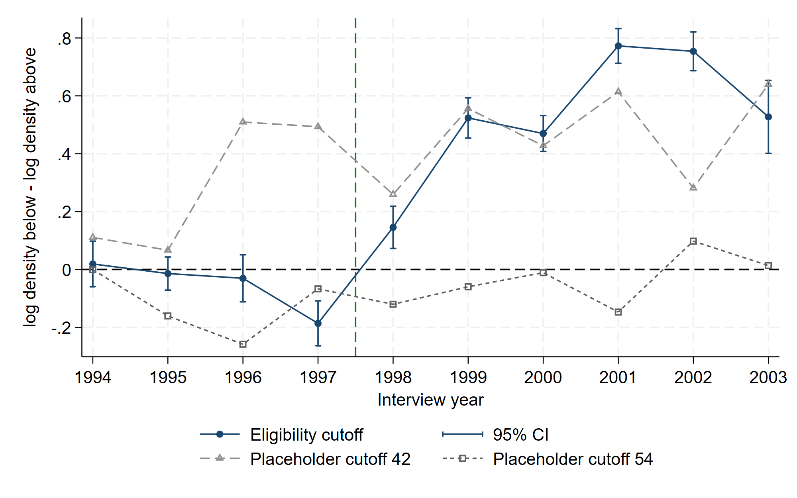

# Detecting Manipulation of Poverty Scores in Colombia's SISBEN

Stata code for my master's seminar paper in *Social Policy Evaluation in Latin America* (Freie Universität Berlin, 2026).

## Question

Colombia's welfare programmes use a poverty index score (SISBEN) to decide who is eligible: households scoring 47 or lower qualify. Camacho & Conover (2011) showed that after the cutoff became public in 1997–98, unusually many households appeared just below it, a sign that scores were manipulated.

This project replicates their discontinuity estimates and tests them with a modern density test.

## What the code does

1. **Sample construction:** rebuilds the score from its components, flags and removes inconsistent records (~0.03%), and collapses the data to the family level.
2. **Replication:** re-estimates the authors' yearly discontinuity at the cutoff (their Table 3) for individuals and families.
3. **Extension:** applies the Cattaneo–Jansson–Ma (CJM) density test (`rddensity`) per year, with automatic and fixed bandwidths, plus placebo cutoffs at 42 and 54.
4. **Municipality level:** compares the authors' bin-difference measure with CJM estimates for each municipality–year.
5. **Figures and tables:** score histograms, CJM estimates over time, and a combined results table.

## Results

<!-- Add 1–2 sentences with your main finding here, e.g. the size of the jump after 1998 -->

- **Exact replication.** My estimates match the published yearly discontinuities to the third decimal in all ten years. They barely change when families instead of individuals are the unit of analysis.
- **The modern test confirms the timing.** With the CJM density estimator, the jump at the cutoff is close to zero before 1998 and positive and significant from 1998 onward. From 1999, the density just below the cutoff is 1.6 to 2.2 times the density just above it.
- **But single estimates can mislead.** The test also finds significant jumps at placebo cutoffs where no rule applies. The cause: the score is a sum of a few discrete components, so thousands of families share exact values (e.g. 24,947 at 41.71), which breaks the estimator's continuity assumption.
- **The change over time is the real evidence.** From 1994–97 to 1998–2003, the estimate rises by 0.59 at the eligibility cutoff, but only by 0.17 and 0.08 at the placebo cutoffs.
- **Municipality level:** the density-based and the original bin-based measures agree only moderately (rank correlation 0.27), so the new measure is no simple substitute.
**Takeaway:** density tests on constructed poverty scores need placebo cutoffs to tell manipulation apart from discreteness in the score.

## How to run

1. Download the replication data for Camacho & Conover (2011), *American Economic Journal: Economic Policy* 3(2), from the [AEA website](https://www.aeaweb.org/articles?id=10.1257/pol.3.2.41) and put `sisben_aejep.dta` into `data/`.
2. Open Stata 17 or newer in the repository folder and run `replication.do`. Missing packages (`rddensity`, `lpdensity`, `estout`) install automatically.
3. Slow parts can be switched on or off at the top of the file (`RUN_A`, `RUN_YEARLY`, `RUN_CELLS`).

The data is not included in this repository.

## Reference

Camacho, A. & Conover, E. (2011). Manipulation of Social Program Eligibility. *American Economic Journal: Economic Policy*, 3(2), 41–65.
